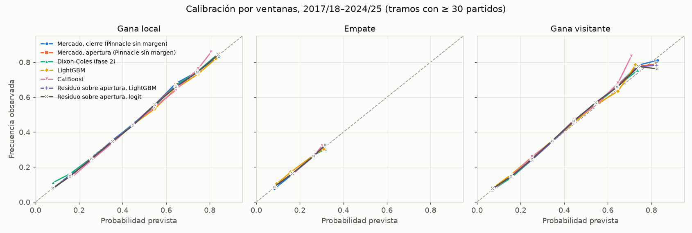

# ¿Puede un modelo de ML ganar al mercado de apuestas de fútbol?

> **In English.** Can an ML model beat the betting market on 1X2 football outcomes? I built Elo,
> pi-ratings, Dixon-Coles, LightGBM, CatBoost and residual models on top of the opening odds, and
> evaluated them walk-forward on 26,660 matches (8 European leagues, 2017/18–2024/25) against
> Pinnacle's no-vig closing line, with week-level bootstrap CIs, a hash-chained log of every variant
> tried and leakage tests validated with deliberate mutants. **Result: nothing beats the closing
> line.** The best model (LightGBM, no odds as input) is +0.0147 log loss worse [95 % CI +0.0128,
> +0.0167]. A small apparent edge over the opening line (−0.0001) was audited and rejected: it comes
> from the de-vig method, not from information. A carefully measured negative result.

## En 30 segundos

- **Problema.** Acertar más partidos no basta: un modelo solo vale si da probabilidades mejores que
  las del mercado. La referencia más dura es el **cierre de Pinnacle sin margen**.
- **Qué hice.** Un histórico de football-data.co.uk (47.991 partidos, 8 ligas, 2012/13–2026/27),
  modelos clásicos de fútbol (Elo, pi-ratings, Dixon-Coles), *gradient boosting* con 53 variables
  previas al partido y modelos de residuos que corrigen la cuota de apertura. Todo evaluado por
  ventanas temporales, sin mirar la temporada 2025/26.
- **Resultado.** **Ningún modelo gana al cierre**, en ninguna de las 8 temporadas. Los árboles
  mejoran a Dixon-Coles, pero quedan muy por detrás del mercado.
- **Por qué es interesante.** Por cómo se mide: intervalos que respetan la dependencia entre
  partidos de una jornada, registro inalterable de cada variante probada, tests antifuga que se
  validan inyectando fugas a propósito y una auditoría que **tumbó el único resultado
  «positivo»**.

Es un proyecto de investigación y simulación. No se apuesta dinero real ni hay apuestas
automáticas.

## Resultado: 2017/18–2024/25

26.660 partidos con probabilidad de todos los modelos (8 ligas: Premier, Championship, League One,
LaLiga, LaLiga 2, Bundesliga, Serie A y Ligue 1). Log loss multiclase 1X2: menor es mejor.
**Δ > 0 significa peor que el cierre.** IC 95 % por bootstrap de semanas.

| Modelo | Log loss [IC 95 %] | Δ log loss vs cierre [IC 95 %] |
|---|---|---|
| Mercado: cierre de Pinnacle sin margen | 0.9944 [0.9895, 0.9992] | — |
| Mercado: apertura de Pinnacle sin margen | 0.9972 [0.9924, 1.0019] | +0.0028 [+0.0018, +0.0037] |
| Elo | 1.0144 [1.0092, 1.0193] | +0.0200 [+0.0176, +0.0223] |
| Pi-ratings | 1.0153 [1.0100, 1.0203] | +0.0209 [+0.0183, +0.0234] |
| Dixon-Coles | 1.0134 [1.0085, 1.0178] | +0.0190 [+0.0168, +0.0212] |
| LightGBM (sin cuotas) | 1.0092 [1.0042, 1.0139] | +0.0147 [+0.0128, +0.0167] |
| CatBoost (sin cuotas) | 1.0099 [1.0049, 1.0145] | +0.0155 [+0.0135, +0.0174] |
| Residuo sobre la apertura (LightGBM) | 0.9971 [0.9922, 1.0019] | +0.0027 [+0.0017, +0.0036] |

Cómo leerlo:

- El mercado mejora de la apertura al cierre (+0.0028): es la escala de lo que aprende en los días
  previos al partido.
- Los mejores modelos sin cuotas (LightGBM, CatBoost) se quedan a unas cinco veces esa distancia
  del cierre. Por temporadas, todos los modelos sin cuotas son peores que el cierre con el IC entero
  por encima de 0 en las 8 de 8.
- **El único resultado prometedor no sobrevivió a la auditoría.** El residuo LightGBM mejoraba a
  la apertura en −0.0001 de log loss. No era una fuga: la normalización proporcional reparte mal el
  margen entre favorito y sorpresa, y normalizando la apertura con el método de Shin, sin ningún
  modelo, se obtiene la misma mejora. Frente a la apertura con Shin, el residuo queda en
  +0.00003 [−0.00010, +0.00017], y quitando el 1 % de partidos más favorables pasa a ser peor.

Informes completos, con tablas por temporada y liga, calibración y la auditoría:
[`docs/referencias.md`](docs/referencias.md) (fase 2) y [`docs/ml.md`](docs/ml.md) (fase 3).



## Cómo se ha medido

- **Integridad temporal.** Elo y pi-ratings se actualizan al cerrar cada día; Dixon-Coles se
  reajusta cada lunes con lo anterior. El ML de la temporada S se entrena con 2013/14…S−1. Los
  modelos de residuos solo ven lo que existía cuando football-data recogió la apertura (martes o
  viernes por la tarde), y hay una tabla de sensibilidad sin las jornadas de Navidad, donde ese
  supuesto falla.
- **Ajuste separado de la evaluación.** Hiperparámetros elegidos en 2013/14–2016/17 (fase 2) y
  2014/15–2016/17 (fase 3), con rejillas fijadas antes de mirar. La temporada 2025/26 es la prueba
  final: el cargador de datos ni siquiera abre esos CSV.
- **Intervalos honestos.** Bootstrap por semanas ISO (350 semanas, 2.000 remuestras) y diferencias
  emparejadas partido a partido: los partidos de una jornada no son independientes.
- **Todo experimento cuenta.** [`experiments/registro.jsonl`](experiments/registro.jsonl) guarda
  una fila por variante evaluada (111 filas), también las que fallan, con hash de datos y commit.
  Cada fila lleva el hash de la anterior, así que borrar o editar una se detecta
  (`src/experiments.verify`).
- **Antifuga con mutantes.** Los tests comprueban que alterar resultados desde un día *c* no cambia
  ninguna predicción anterior y que las cuotas de cierre no influyen en nada. Para saber que esos
  tests sirven, seis versiones con fugas deliberadas (ancla equivocada, media sin agrupar por
  equipo, incluir el propio día, el cierre como variable, entrenar con la temporada evaluada,
  escalar con la prueba) deben fallarlos, y fallan.
- **Auditoría independiente** (un agente revisor con instrucciones de buscar fugas y errores de
  métrica) en cada fase. Sus reservas y cómo se corrigieron están en
  [`docs/decisions.md`](docs/decisions.md).
- **Cuidado con los datos.** Por ejemplo, las columnas `PP*` que aparecen en 2026/27 parecen
  Pinnacle, pero su margen medio es del 8,3 % frente al 3,4 % de Pinnacle: no se usan como
  referencia ([`docs/calidad-datos.md`](docs/calidad-datos.md)).

## Reproducir

Python 3.11. Las versiones exactas están en `requirements.txt`.

```bash
python3 -m venv .venv && source .venv/bin/activate
pip install -r requirements.txt
python -m pytest                                   # 119 tests, sin red

# Datos: football-data.co.uk (gratuito). Su robots.txt bloquea a los bots de IA, así que el
# script lo ejecuta una persona desde su terminal; una petición por segundo.
python scripts/descargar_football_data.py
python scripts/informe_calidad.py                  # tabla unificada + docs/calidad-datos.md

python scripts/fase2_referencias.py evaluacion     # Elo, pi, Dixon-Coles → docs/referencias.md
python scripts/fase3_ml.py evaluacion              # LightGBM, CatBoost, residuos → docs/ml.md
```

Los modos `ajuste` de ambos scripts repiten la búsqueda de hiperparámetros. Cada ejecución añade
filas al registro; los datos de partidos no se suben al repo (solo agregados).

## Estructura

| Ruta | Qué hay |
|---|---|
| `src/football_data.py` | Carga y unificación del histórico, identidad de equipos |
| `src/ratings.py`, `src/dixon_coles.py` | Elo, pi-ratings y Dixon-Coles por ventanas |
| `src/features.py`, `src/ml.py` | Variables con hora de decisión, LightGBM, CatBoost y residuos |
| `src/metrics.py`, `src/referencias.py` | Log loss, RPS, ECE, bootstrap por semanas, evaluación |
| `src/experiments.py` | Registro de experimentos encadenado por hash |
| `scripts/` | Descarga, informe de calidad y evaluaciones de las fases 2 y 3 |
| `tests/` | Antifuga, divisiones temporales, métricas, modelos |
| `docs/` | Plan, decisiones, calidad de datos e informes de resultados |

`src/extract_pipeline.py` y `src/train_xgboost.py` son de una primera etapa con soccerdata
(Understat, ClubElo) y un XGBoost de Over 2,5 que no se comparaba con el mercado; se conservan,
pero no forman parte de los resultados. `.specify/` y `.github/` también son de esa etapa.

## Siguiente

Fase 4: usar Shin o potencia como normalización de referencia (como variante registrada) y
recoger cuotas propias con marca de tiempo para medir CLV (*closing line value*): si un modelo
anticipa hacia dónde se mueve la cuota, aunque no gane al cierre. El plan completo y los criterios
para avanzar de fase están en [`docs/plan-modelo.md`](docs/plan-modelo.md).
