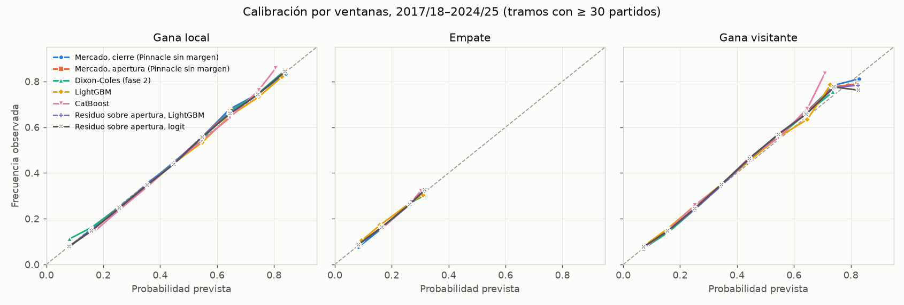

# Modelos de ML 1X2 (fase 3)

Generado con `scripts/fase3_ml.py evaluacion` el 2026-11-15. Solo agregados; los
datos de partidos no se suben. Hash de los datos evaluados: `3e3b9ea6a34b8bf2`.

## Qué se compara

- **LightGBM y CatBoost** sobre 53 variables previas al partido: Elo y
  pi-ratings (nivel y diferencia), probabilidades de Dixon-Coles, forma de los últimos 5 y 20 partidos
  (goles, tiros, tiros a puerta, córners y puntos, a favor y en contra), descanso, partidos jugados en
  la temporada, liga y categoría. Deciden **antes del saque**: ven los resultados de días anteriores.
  **No ven ninguna cuota.**
- **Modelos de residuos sobre la apertura:** parten de la apertura de Pinnacle sin margen y aprenden
  solo la corrección, log p = log p_apertura + f(x). Dos versiones: LightGBM con la apertura como
  `init_score` y una regresión softmax con desplazamiento y penalización L2. Deciden **cuando se
  recoge la apertura** (viernes por la tarde para partidos de viernes a lunes, martes por la tarde
  para martes a jueves, según football-data): solo ven resultados anteriores a ese día.
- Referencias: el **cierre** y la **apertura** de Pinnacle sin margen, y Dixon-Coles de la fase 2.

## Cómo se ha medido

- **Ventanas.** Para predecir la temporada S se entrena un modelo con 2013/14…S − 1. Las
  variables de entrenamiento son las que existían en su día (ratings en línea, Dixon-Coles por
  ventanas), así que no hay predicciones «del futuro» apiladas.
- **Ajuste.** Rejilla fijada antes de mirar, en 2014/15–2016/17 (27 variantes distintas en dos rondas y 43 filas del registro, incluida una primera
  ejecución con el fallo de inicialización de Elo/pi ya corregido;
  regla: mínimo log loss). Elo, pi y Dixon-Coles usan los hiperparámetros elegidos en la fase 2.
  Evaluaciones de ML registradas hasta hoy: 1. **2025/26 no se ha leído.**
- **Conjunto común.** 26660 partidos con probabilidad de todos los modelos y ambas cuotas
  de Pinnacle (75 descartados).
- **Intervalos.** IC 95 % por bootstrap de semanas ISO (350 semanas; 2.000
  remuestras en el total, la ventana reciente y la tabla sin Navidad, 1.000 por temporada y 500 por
  liga). Δ son diferencias emparejadas partido a partido; **Δ > 0 significa peor que la referencia.**
  Las tablas por temporada y liga son muchas comparaciones: algún IC suelto por debajo de 0 es
  esperable por azar y no cuenta como ventaja.
- **Antifuga.** `tests/test_ml.py`: alterar resultados y estadísticas desde un día c no cambia ninguna
  variable ni predicción de partidos cuya ancla sea ≤ c (también los posteriores a c con la apertura),
  y cambiar las cuotas de cierre no cambia ninguna predicción. Seis mutantes con fugas deliberadas
  (ancla equivocada, media sin agrupar, día incluido, cierre como variable, entrenar con la temporada
  evaluada, escalado con la prueba) son detectados.

Hiperparámetros elegidos (ronda 1 fijada antes de mirar; ronda 2 añadida porque la 1 elegía
siempre el borde menos complejo, también en las temporadas de ajuste):

- **LightGBM:** `{"leaves": 3, "rounds": 300, "lr": 0.02, "min_leaf": 200}`
- **CatBoost:** `{"depth": 2, "iterations": 200, "lr": 0.03}`
- **Residuo sobre apertura, LightGBM:** `{"leaves": 3, "rounds": 25, "lr": 0.01, "min_leaf": 500, "l2": 10.0}`
- **Residuo sobre apertura, logit:** `{"alpha": 1.0}`

## Resultado: 2017/18–2024/25

| Modelo | Log loss [IC 95 %] | Δ log loss vs cierre | Δ log loss vs apertura | RPS [IC 95 %] | Δ RPS vs cierre | ECE |
|---|---|---|---|---|---|---|
| Mercado, cierre (Pinnacle sin margen) | 0.9944 [0.9895, 0.9992] | — | -0.0028 [-0.0037, -0.0018] | 0.2015 [0.2001, 0.2029] | — | 0.0067 |
| Mercado, apertura (Pinnacle sin margen) | 0.9972 [0.9924, 1.0019] | +0.0028 [+0.0018, +0.0037] | — | 0.2024 [0.2010, 0.2037] | +0.0009 [+0.0005, +0.0011] | 0.0071 |
| Dixon-Coles (fase 2) | 1.0134 [1.0085, 1.0178] | +0.0190 [+0.0168, +0.0212] | +0.0162 [+0.0142, +0.0182] | 0.2075 [0.2061, 0.2088] | +0.0059 [+0.0052, +0.0066] | 0.0074 |
| LightGBM | 1.0092 [1.0042, 1.0139] | +0.0147 [+0.0128, +0.0167] | +0.0119 [+0.0101, +0.0138] | 0.2060 [0.2046, 0.2074] | +0.0045 [+0.0039, +0.0051] | 0.0075 |
| CatBoost | 1.0099 [1.0049, 1.0145] | +0.0155 [+0.0135, +0.0174] | +0.0127 [+0.0108, +0.0145] | 0.2063 [0.2049, 0.2077] | +0.0048 [+0.0041, +0.0054] | 0.0079 |
| Residuo sobre apertura, LightGBM | 0.9971 [0.9922, 1.0019] | +0.0027 [+0.0017, +0.0036] | -0.0001 [-0.0002, -0.0000] | 0.2023 [0.2010, 0.2037] | +0.0008 [+0.0005, +0.0011] | 0.0062 |
| Residuo sobre apertura, logit | 0.9971 [0.9923, 1.0019] | +0.0027 [+0.0018, +0.0036] | -0.0001 [-0.0002, +0.0000] | 0.2024 [0.2010, 0.2037] | +0.0008 [+0.0005, +0.0011] | 0.0071 |

ECE: error de calibración esperado (10 tramos, media de los tres resultados).

### Solo 2021/22–2024/25

| Modelo | Log loss | Δ vs cierre | Δ vs apertura |
|---|---|---|---|
| Mercado, cierre (Pinnacle sin margen) | 0.9925 [0.9858, 0.9992] | — | -0.0024 [-0.0036, -0.0011] |
| Mercado, apertura (Pinnacle sin margen) | 0.9949 [0.9884, 1.0014] | +0.0024 [+0.0011, +0.0036] | — |
| Dixon-Coles (fase 2) | 1.0112 [1.0049, 1.0174] | +0.0186 [+0.0153, +0.0216] | +0.0162 [+0.0132, +0.0190] |
| LightGBM | 1.0068 [1.0001, 1.0134] | +0.0142 [+0.0115, +0.0167] | +0.0119 [+0.0094, +0.0142] |
| CatBoost | 1.0069 [1.0003, 1.0133] | +0.0143 [+0.0115, +0.0168] | +0.0119 [+0.0094, +0.0143] |
| Residuo sobre apertura, LightGBM | 0.9948 [0.9883, 1.0013] | +0.0023 [+0.0010, +0.0035] | -0.0001 [-0.0002, +0.0000] |
| Residuo sobre apertura, logit | 0.9948 [0.9882, 1.0013] | +0.0022 [+0.0009, +0.0035] | -0.0002 [-0.0003, -0.0000] |

### Sin las jornadas de Navidad (20-dic a 5-ene)

En esas jornadas seguidas football-data recogió la apertura antes de lo supuesto, así que los
residuos podrían ver resultados que la cuota aún no tenía. Se quitan 1449 partidos:

| Modelo | Δ vs cierre | Δ vs apertura |
|---|---|---|
| Mercado, cierre (Pinnacle sin margen) | — | -0.0026 [-0.0036, -0.0017] |
| Mercado, apertura (Pinnacle sin margen) | +0.0026 [+0.0017, +0.0036] | — |
| Dixon-Coles (fase 2) | +0.0189 [+0.0165, +0.0212] | +0.0163 [+0.0141, +0.0184] |
| LightGBM | +0.0147 [+0.0128, +0.0167] | +0.0121 [+0.0103, +0.0140] |
| CatBoost | +0.0153 [+0.0133, +0.0173] | +0.0127 [+0.0108, +0.0145] |
| Residuo sobre apertura, LightGBM | +0.0025 [+0.0015, +0.0035] | -0.0001 [-0.0002, -0.0000] |
| Residuo sobre apertura, logit | +0.0025 [+0.0016, +0.0035] | -0.0001 [-0.0002, +0.0000] |

## Por temporada

Δ log loss frente al **cierre** (IC 95 %):

| Temporada | N | Log loss cierre | Δ LightGBM | Δ CatBoost | Δ Residuo sobre apertura, LightGBM | Δ Residuo sobre apertura, logit |
|---|---|---|---|---|---|---|
| 2017/18 | 3377 | 0.9829 | +0.0156 [+0.0097, +0.0216] | +0.0161 [+0.0100, +0.0224] | +0.0036 [+0.0011, +0.0060] | +0.0035 [+0.0009, +0.0061] |
| 2018/19 | 3368 | 0.9914 | +0.0147 [+0.0099, +0.0197] | +0.0171 [+0.0119, +0.0226] | +0.0024 [-0.0003, +0.0049] | +0.0024 [-0.0002, +0.0049] |
| 2019/20 | 3124 | 1.0058 | +0.0115 [+0.0053, +0.0176] | +0.0135 [+0.0074, +0.0197] | +0.0031 [+0.0002, +0.0060] | +0.0032 [+0.0003, +0.0061] |
| 2020/21 | 3376 | 1.0058 | +0.0189 [+0.0133, +0.0248] | +0.0196 [+0.0139, +0.0252] | +0.0031 [+0.0001, +0.0060] | +0.0036 [+0.0005, +0.0065] |
| 2021/22 | 3389 | 0.9954 | +0.0148 [+0.0100, +0.0197] | +0.0149 [+0.0101, +0.0196] | +0.0017 [-0.0006, +0.0038] | +0.0016 [-0.0007, +0.0038] |
| 2022/23 | 3392 | 1.0013 | +0.0091 [+0.0035, +0.0142] | +0.0087 [+0.0032, +0.0136] | +0.0024 [-0.0003, +0.0054] | +0.0022 [-0.0006, +0.0052] |
| 2023/24 | 3316 | 0.9862 | +0.0152 [+0.0091, +0.0209] | +0.0161 [+0.0097, +0.0223] | +0.0027 [+0.0003, +0.0051] | +0.0027 [+0.0004, +0.0051] |
| 2024/25 | 3318 | 0.9870 | +0.0179 [+0.0135, +0.0222] | +0.0177 [+0.0128, +0.0226] | +0.0024 [+0.0000, +0.0049] | +0.0024 [+0.0000, +0.0049] |

Δ log loss frente a la **apertura** (IC 95 %):

| Temporada | Δ LightGBM | Δ CatBoost | Δ Residuo sobre apertura, LightGBM | Δ Residuo sobre apertura, logit |
|---|---|---|---|---|
| 2017/18 | +0.0118 [+0.0071, +0.0169] | +0.0123 [+0.0076, +0.0176] | -0.0002 [-0.0004, +0.0001] | -0.0002 [-0.0005, +0.0001] |
| 2018/19 | +0.0120 [+0.0072, +0.0172] | +0.0144 [+0.0094, +0.0199] | -0.0003 [-0.0006, -0.0001] | -0.0003 [-0.0008, +0.0002] |
| 2019/20 | +0.0083 [+0.0025, +0.0142] | +0.0103 [+0.0044, +0.0159] | -0.0001 [-0.0004, +0.0002] | -0.0001 [-0.0006, +0.0004] |
| 2020/21 | +0.0157 [+0.0107, +0.0207] | +0.0164 [+0.0112, +0.0216] | -0.0000 [-0.0003, +0.0002] | +0.0004 [-0.0000, +0.0008] |
| 2021/22 | +0.0131 [+0.0085, +0.0179] | +0.0132 [+0.0088, +0.0176] | -0.0001 [-0.0003, +0.0002] | -0.0001 [-0.0004, +0.0002] |
| 2022/23 | +0.0068 [+0.0018, +0.0113] | +0.0064 [+0.0016, +0.0109] | +0.0001 [-0.0001, +0.0003] | -0.0001 [-0.0004, +0.0002] |
| 2023/24 | +0.0123 [+0.0073, +0.0174] | +0.0132 [+0.0077, +0.0187] | -0.0002 [-0.0004, +0.0000] | -0.0002 [-0.0004, +0.0001] |
| 2024/25 | +0.0153 [+0.0114, +0.0194] | +0.0150 [+0.0110, +0.0191] | -0.0002 [-0.0004, -0.0000] | -0.0002 [-0.0005, +0.0000] |

## Por liga (Δ log loss frente al cierre / frente a la apertura)

| Liga | N | Log loss cierre | LightGBM (Δ cierre / Δ apertura) | CatBoost (Δ cierre / Δ apertura) | Residuo sobre apertura, LightGBM (Δ cierre / Δ apertura) | Residuo sobre apertura, logit (Δ cierre / Δ apertura) |
|---|---|---|---|---|---|---|
| D1 | 2447 | 0.9789 | +0.0137 / +0.0127 | +0.0143 / +0.0132 | +0.0009 / -0.0002 | +0.0009 / -0.0002 |
| E0 | 3040 | 0.9457 | +0.0154 / +0.0115 | +0.0166 / +0.0127 | +0.0037 / -0.0002 | +0.0040 / +0.0001 |
| E1 | 4411 | 1.0340 | +0.0109 / +0.0093 | +0.0114 / +0.0098 | +0.0016 / +0.0001 | +0.0016 / +0.0001 |
| E2 | 4248 | 1.0198 | +0.0125 / +0.0084 | +0.0151 / +0.0111 | +0.0038 / -0.0003 | +0.0039 / -0.0002 |
| F1 | 2785 | 0.9829 | +0.0196 / +0.0169 | +0.0196 / +0.0169 | +0.0028 / +0.0000 | +0.0030 / +0.0002 |
| I1 | 3036 | 0.9484 | +0.0181 / +0.0158 | +0.0189 / +0.0166 | +0.0022 / -0.0001 | +0.0022 / -0.0001 |
| SP1 | 3036 | 0.9724 | +0.0144 / +0.0112 | +0.0146 / +0.0114 | +0.0030 / -0.0002 | +0.0030 / -0.0002 |
| SP2 | 3657 | 1.0333 | +0.0158 / +0.0126 | +0.0153 / +0.0121 | +0.0030 / -0.0002 | +0.0027 / -0.0005 |

## ¿La corrección anticipa el movimiento del mercado?

Correlación entre la corrección del modelo (p_modelo − p_apertura) y el movimiento de Pinnacle
(p_cierre − p_apertura), con IC 95 % por bootstrap de semanas. Es descriptivo: una correlación
positiva sería la señal que buscaría la fase 4 (CLV), no un beneficio.

| Modelo | Local | Empate | Visitante |
|---|---|---|---|
| Residuo sobre apertura, LightGBM | +0.038 [+0.025, +0.051] | +0.044 [+0.029, +0.058] | +0.053 [+0.038, +0.066] |
| Residuo sobre apertura, logit | -0.026 [-0.040, -0.012] | +0.006 [-0.009, +0.022] | -0.003 [-0.018, +0.012] |

## Variables más útiles para LightGBM

Ganancia relativa en el modelo entrenado hasta 2023/24 (descriptivo).

| Variable | Ganancia |
|---|---|
| `dc_away` | 27.3% |
| `elo_diff` | 23.8% |
| `dc_home` | 16.1% |
| `pi_diff` | 12.8% |
| `dc_draw` | 3.4% |
| `home_sa5` | 1.6% |
| `away_sf20` | 1.4% |
| `away_sa20` | 1.3% |
| `away_cf20` | 1.3% |
| `home_sf5` | 1.2% |

## Calibración

Probabilidad media prevista → frecuencia observada, tramos de 0,1 («—»: menos de 30 partidos).

| Resultado | Tramo | Mercado, cierre (Pinnacle sin margen) | Mercado, apertura (Pinnacle sin margen) | Dixon-Coles (fase 2) | LightGBM | CatBoost | Residuo sobre apertura, LightGBM | Residuo sobre apertura, logit |
|---|---|---|---|---|---|---|---|---|
| local | 0.0–0.1 | 0.079 → 0.074 | 0.080 → 0.078 | 0.082 → 0.112 | — | — | 0.080 → 0.081 | 0.080 → 0.079 |
| local | 0.1–0.2 | 0.158 → 0.154 | 0.159 → 0.147 | 0.160 → 0.162 | 0.163 → 0.151 | 0.168 → 0.143 | 0.159 → 0.148 | 0.159 → 0.148 |
| local | 0.2–0.3 | 0.256 → 0.240 | 0.256 → 0.251 | 0.256 → 0.251 | 0.257 → 0.250 | 0.257 → 0.238 | 0.256 → 0.250 | 0.256 → 0.246 |
| local | 0.3–0.4 | 0.352 → 0.353 | 0.353 → 0.348 | 0.355 → 0.349 | 0.353 → 0.338 | 0.352 → 0.337 | 0.353 → 0.348 | 0.353 → 0.346 |
| local | 0.4–0.5 | 0.448 → 0.444 | 0.448 → 0.444 | 0.448 → 0.449 | 0.447 → 0.442 | 0.448 → 0.442 | 0.447 → 0.443 | 0.448 → 0.438 |
| local | 0.5–0.6 | 0.547 → 0.556 | 0.547 → 0.558 | 0.544 → 0.544 | 0.548 → 0.533 | 0.546 → 0.541 | 0.548 → 0.558 | 0.547 → 0.556 |
| local | 0.6–0.7 | 0.645 → 0.679 | 0.645 → 0.671 | 0.643 → 0.669 | 0.642 → 0.646 | 0.645 → 0.641 | 0.645 → 0.662 | 0.645 → 0.658 |
| local | 0.7–0.8 | 0.744 → 0.746 | 0.743 → 0.742 | 0.744 → 0.747 | 0.747 → 0.733 | 0.746 → 0.762 | 0.743 → 0.742 | 0.743 → 0.743 |
| local | 0.8–0.9 | 0.841 → 0.834 | 0.840 → 0.849 | 0.838 → 0.848 | 0.829 → 0.821 | 0.806 → 0.857 | 0.840 → 0.845 | 0.839 → 0.843 |
| local | 0.9–1.0 | — | — | — | — | — | — | — |
| empate | 0.0–0.1 | 0.084 → 0.077 | 0.084 → 0.091 | 0.083 → 0.091 | 0.093 → 0.104 | — | 0.084 → 0.089 | 0.083 → 0.086 |
| empate | 0.1–0.2 | 0.164 → 0.156 | 0.165 → 0.162 | 0.168 → 0.160 | 0.159 → 0.172 | 0.170 → 0.162 | 0.165 → 0.163 | 0.165 → 0.162 |
| empate | 0.2–0.3 | 0.265 → 0.263 | 0.265 → 0.263 | 0.260 → 0.267 | 0.265 → 0.270 | 0.270 → 0.273 | 0.264 → 0.264 | 0.264 → 0.264 |
| empate | 0.3–0.4 | 0.317 → 0.318 | 0.315 → 0.324 | 0.317 → 0.302 | 0.311 → 0.304 | 0.303 → 0.323 | 0.315 → 0.322 | 0.315 → 0.325 |
| empate | 0.4–0.5 | — | — | — | — | — | — | — |
| visitante | 0.0–0.1 | 0.071 → 0.068 | 0.072 → 0.076 | 0.071 → 0.069 | 0.077 → 0.085 | 0.083 → 0.081 | 0.072 → 0.077 | 0.071 → 0.077 |
| visitante | 0.1–0.2 | 0.157 → 0.150 | 0.157 → 0.145 | 0.160 → 0.142 | 0.157 → 0.157 | 0.158 → 0.151 | 0.157 → 0.147 | 0.157 → 0.146 |
| visitante | 0.2–0.3 | 0.251 → 0.241 | 0.251 → 0.240 | 0.252 → 0.241 | 0.251 → 0.257 | 0.251 → 0.258 | 0.251 → 0.240 | 0.251 → 0.245 |
| visitante | 0.3–0.4 | 0.345 → 0.345 | 0.345 → 0.345 | 0.345 → 0.345 | 0.346 → 0.352 | 0.345 → 0.348 | 0.344 → 0.345 | 0.345 → 0.350 |
| visitante | 0.4–0.5 | 0.443 → 0.464 | 0.443 → 0.464 | 0.444 → 0.460 | 0.443 → 0.452 | 0.443 → 0.468 | 0.443 → 0.460 | 0.443 → 0.463 |
| visitante | 0.5–0.6 | 0.546 → 0.566 | 0.545 → 0.566 | 0.542 → 0.553 | 0.547 → 0.558 | 0.545 → 0.553 | 0.545 → 0.570 | 0.546 → 0.569 |
| visitante | 0.6–0.7 | 0.644 → 0.667 | 0.644 → 0.665 | 0.642 → 0.660 | 0.647 → 0.634 | 0.647 → 0.681 | 0.644 → 0.659 | 0.643 → 0.657 |
| visitante | 0.7–0.8 | 0.741 → 0.783 | 0.739 → 0.776 | 0.737 → 0.754 | 0.728 → 0.785 | 0.708 → 0.833 | 0.740 → 0.773 | 0.740 → 0.776 |
| visitante | 0.8–0.9 | 0.828 → 0.811 | 0.823 → 0.789 | — | — | — | 0.825 → 0.783 | 0.826 → 0.762 |

## Lectura

- **Mercado, apertura (Pinnacle sin margen):** Δ +0.0028, peor que el cierre (IC entero por encima de 0).
- **Dixon-Coles (fase 2):** Δ +0.0190, peor que el cierre (IC entero por encima de 0); frente a la apertura Δ +0.0162, peor que la apertura (IC entero por encima de 0). Por temporadas frente a la apertura: mejor en 0 de 8, peor en 8.
- **LightGBM:** Δ +0.0147, peor que el cierre (IC entero por encima de 0); frente a la apertura Δ +0.0119, peor que la apertura (IC entero por encima de 0). Por temporadas frente a la apertura: mejor en 0 de 8, peor en 8.
- **CatBoost:** Δ +0.0155, peor que el cierre (IC entero por encima de 0); frente a la apertura Δ +0.0127, peor que la apertura (IC entero por encima de 0). Por temporadas frente a la apertura: mejor en 0 de 8, peor en 8.
- **Residuo sobre apertura, LightGBM:** Δ +0.0027, peor que el cierre (IC entero por encima de 0); frente a la apertura Δ -0.0001, **mejor que la apertura: sospechoso hasta auditarlo**. Por temporadas frente a la apertura: mejor en 2 de 8, peor en 0.
- **Residuo sobre apertura, logit:** Δ +0.0027, peor que el cierre (IC entero por encima de 0); frente a la apertura Δ -0.0001, indistinguible de la apertura con esta muestra. Por temporadas frente a la apertura: mejor en 0 de 8, peor en 0.
