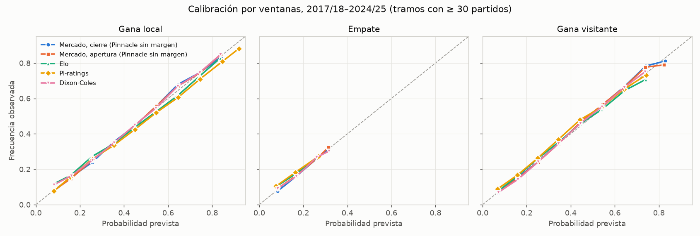

# Modelos de referencia 1X2 (fase 2)

Generado con `scripts/fase2_referencias.py evaluacion` el 2026-11-15. Solo agregados;
los datos de partidos no se suben. Hash de los datos evaluados: `3e3b9ea6a34b8bf2`.

## Cómo se ha medido

- **Ventanas temporales.** Elo y pi-ratings se actualizan tras cada día de partidos y su traducción a
  1X2 (logit ordenado) se ajusta, para cada temporada, solo con las anteriores. Dixon-Coles se
  reajusta cada lunes con los partidos anteriores a ese lunes (4 años como máximo, peso
  exp(−ξ·días)). Ninguna predicción usa partidos de su mismo día ni posteriores (tests en
  `tests/test_referencias.py`).
- **Temporadas.** 2012/13 arranca los ratings. 2013/14–2016/17 sirvió para elegir hiperparámetros
  (39 variantes distintas en 62 filas del registro; regla: mínimo log loss). 2017/18–2024/25 es la evaluación (evaluaciones registradas
  hasta hoy: 3). **2025/26 no se ha leído.**
- **Conjunto común.** 26660 partidos de 8 ligas con probabilidad de todos los modelos
  (75 descartados por faltar alguna cuota). La referencia es el cierre de
  Pinnacle sin margen (normalización proporcional).
- **Intervalos.** IC 95 % por bootstrap de semanas (350 semanas ISO, 2.000
  remuestras): los partidos de una misma jornada no son independientes. Las diferencias (Δ) son
  emparejadas, partido a partido, frente al cierre; **Δ > 0 significa peor que el mercado.**

Hiperparámetros elegidos en el ajuste:

- **Elo:** `{"k": 20, "goal_mult": true, "season_regress": 0.0}`
- **Pi-ratings:** `{"lam": 0.035, "gamma": 0.7}`
- **Dixon-Coles:** `{"xi": 0.002, "newcomer": 0.0}`

## Resultado: 2017/18–2024/25

| Modelo | Log loss [IC 95 %] | RPS [IC 95 %] | Δ log loss vs cierre | Δ RPS vs cierre | ECE |
|---|---|---|---|---|---|
| Mercado, cierre (Pinnacle sin margen) | 0.9944 [0.9895, 0.9992] | 0.2015 [0.2001, 0.2029] | — | — | 0.0067 |
| Mercado, apertura (Pinnacle sin margen) | 0.9972 [0.9924, 1.0019] | 0.2024 [0.2010, 0.2037] | +0.0028 [+0.0018, +0.0037] | +0.0009 [+0.0005, +0.0011] | 0.0071 |
| Elo | 1.0144 [1.0092, 1.0193] | 0.2077 [0.2062, 0.2091] | +0.0200 [+0.0176, +0.0223] | +0.0062 [+0.0054, +0.0069] | 0.0088 |
| Pi-ratings | 1.0153 [1.0100, 1.0203] | 0.2080 [0.2064, 0.2095] | +0.0209 [+0.0183, +0.0234] | +0.0064 [+0.0056, +0.0072] | 0.0150 |
| Dixon-Coles | 1.0134 [1.0085, 1.0178] | 0.2075 [0.2061, 0.2088] | +0.0190 [+0.0168, +0.0212] | +0.0059 [+0.0052, +0.0066] | 0.0074 |

ECE: error de calibración esperado (10 tramos, media de local, empate y visitante).

### Solo 2021/22–2024/25 (ventana de validación del plan)

| Modelo | Log loss | RPS | Δ log loss vs cierre |
|---|---|---|---|
| Mercado, cierre (Pinnacle sin margen) | 0.9925 [0.9858, 0.9992] | 0.2011 [0.1991, 0.2031] | — |
| Mercado, apertura (Pinnacle sin margen) | 0.9949 [0.9884, 1.0014] | 0.2019 [0.1999, 0.2038] | +0.0024 [+0.0011, +0.0036] |
| Elo | 1.0106 [1.0039, 1.0173] | 0.2066 [0.2045, 0.2087] | +0.0180 [+0.0150, +0.0210] |
| Pi-ratings | 1.0111 [1.0043, 1.0180] | 0.2068 [0.2046, 0.2089] | +0.0185 [+0.0152, +0.0217] |
| Dixon-Coles | 1.0112 [1.0049, 1.0174] | 0.2070 [0.2050, 0.2088] | +0.0186 [+0.0153, +0.0216] |

## Por temporada (Δ log loss frente al cierre, IC 95 %)

| Temporada | N | Log loss cierre | Δ Mercado, apertura (Pinnacle sin margen) | Δ Elo | Δ Pi-ratings | Δ Dixon-Coles |
|---|---|---|---|---|---|---|
| 2017/18 | 3377 | 0.9829 | +0.0038 [+0.0012, +0.0063] | +0.0197 [+0.0125, +0.0273] | +0.0200 [+0.0113, +0.0288] | +0.0205 [+0.0131, +0.0279] |
| 2018/19 | 3368 | 0.9914 | +0.0027 [+0.0001, +0.0052] | +0.0224 [+0.0162, +0.0286] | +0.0232 [+0.0177, +0.0294] | +0.0201 [+0.0145, +0.0260] |
| 2019/20 | 3124 | 1.0058 | +0.0032 [+0.0003, +0.0062] | +0.0193 [+0.0116, +0.0269] | +0.0192 [+0.0124, +0.0267] | +0.0163 [+0.0104, +0.0221] |
| 2020/21 | 3376 | 1.0058 | +0.0032 [+0.0001, +0.0060] | +0.0261 [+0.0184, +0.0330] | +0.0304 [+0.0224, +0.0385] | +0.0206 [+0.0136, +0.0272] |
| 2021/22 | 3389 | 0.9954 | +0.0017 [-0.0005, +0.0039] | +0.0186 [+0.0130, +0.0237] | +0.0190 [+0.0124, +0.0252] | +0.0212 [+0.0148, +0.0275] |
| 2022/23 | 3392 | 1.0013 | +0.0023 [-0.0004, +0.0053] | +0.0112 [+0.0045, +0.0172] | +0.0131 [+0.0056, +0.0199] | +0.0132 [+0.0072, +0.0188] |
| 2023/24 | 3316 | 0.9862 | +0.0029 [+0.0004, +0.0053] | +0.0206 [+0.0145, +0.0263] | +0.0200 [+0.0127, +0.0267] | +0.0192 [+0.0126, +0.0252] |
| 2024/25 | 3318 | 0.9870 | +0.0026 [+0.0002, +0.0052] | +0.0217 [+0.0157, +0.0279] | +0.0222 [+0.0160, +0.0283] | +0.0210 [+0.0150, +0.0272] |

2019/20 y 2020/21 incluyen partidos sin público.

## Por liga (Δ log loss frente al cierre)

| Liga | N | Log loss cierre | Δ Mercado, apertura (Pinnacle sin margen) | Δ Elo | Δ Pi-ratings | Δ Dixon-Coles |
|---|---|---|---|---|---|---|
| D1 | 2447 | 0.9789 | +0.0011 | +0.0195 | +0.0213 | +0.0209 |
| E0 | 3040 | 0.9457 | +0.0039 | +0.0206 | +0.0219 | +0.0179 |
| E1 | 4411 | 1.0340 | +0.0015 | +0.0142 | +0.0176 | +0.0138 |
| E2 | 4248 | 1.0198 | +0.0041 | +0.0220 | +0.0247 | +0.0191 |
| F1 | 2785 | 0.9829 | +0.0028 | +0.0242 | +0.0245 | +0.0219 |
| I1 | 3036 | 0.9484 | +0.0023 | +0.0226 | +0.0215 | +0.0228 |
| SP1 | 3036 | 0.9724 | +0.0031 | +0.0182 | +0.0189 | +0.0174 |
| SP2 | 3657 | 1.0333 | +0.0032 | +0.0203 | +0.0178 | +0.0209 |

## Calibración

Probabilidad media prevista → frecuencia observada (partidos), por tramos de 0,1. «—»: menos de
30 partidos en el tramo.

| Resultado | Tramo | Mercado, cierre (Pinnacle sin margen) | Mercado, apertura (Pinnacle sin margen) | Elo | Pi-ratings | Dixon-Coles |
|---|---|---|---|---|---|---|
| local | 0.0–0.1 | 0.079 → 0.074 (284) | 0.080 → 0.078 (256) | 0.083 → 0.118 (169) | 0.082 → 0.076 (184) | 0.082 → 0.112 (134) |
| local | 0.1–0.2 | 0.158 → 0.154 (1638) | 0.159 → 0.147 (1574) | 0.158 → 0.165 (1403) | 0.157 → 0.157 (1194) | 0.160 → 0.162 (1151) |
| local | 0.2–0.3 | 0.256 → 0.240 (3588) | 0.256 → 0.251 (3444) | 0.255 → 0.272 (3457) | 0.256 → 0.256 (2796) | 0.256 → 0.251 (3138) |
| local | 0.3–0.4 | 0.352 → 0.353 (6175) | 0.353 → 0.348 (6328) | 0.353 → 0.343 (5790) | 0.354 → 0.336 (5579) | 0.355 → 0.349 (6687) |
| local | 0.4–0.5 | 0.448 → 0.444 (6392) | 0.448 → 0.444 (6587) | 0.450 → 0.437 (6422) | 0.450 → 0.425 (7052) | 0.448 → 0.449 (7684) |
| local | 0.5–0.6 | 0.547 → 0.556 (4478) | 0.547 → 0.558 (4459) | 0.547 → 0.526 (4929) | 0.546 → 0.519 (5154) | 0.544 → 0.544 (4563) |
| local | 0.6–0.7 | 0.645 → 0.679 (2341) | 0.645 → 0.671 (2305) | 0.645 → 0.617 (2720) | 0.645 → 0.605 (2709) | 0.643 → 0.669 (2079) |
| local | 0.7–0.8 | 0.744 → 0.746 (1227) | 0.743 → 0.742 (1208) | 0.743 → 0.726 (1286) | 0.744 → 0.709 (1271) | 0.744 → 0.747 (880) |
| local | 0.8–0.9 | 0.841 → 0.834 (512) | 0.840 → 0.849 (482) | 0.837 → 0.828 (476) | 0.846 → 0.809 (611) | 0.838 → 0.848 (329) |
| local | 0.9–1.0 | — | — | — | 0.922 → 0.882 (110) | — |
| empate | 0.0–0.1 | 0.084 → 0.077 (209) | 0.084 → 0.091 (175) | 0.086 → 0.109 (147) | 0.076 → 0.104 (386) | 0.083 → 0.091 (99) |
| empate | 0.1–0.2 | 0.164 → 0.156 (2656) | 0.165 → 0.162 (2664) | 0.165 → 0.173 (2603) | 0.164 → 0.182 (2584) | 0.168 → 0.160 (2081) |
| empate | 0.2–0.3 | 0.265 → 0.263 (18358) | 0.265 → 0.263 (19296) | 0.270 → 0.273 (23910) | 0.270 → 0.274 (23690) | 0.260 → 0.267 (21092) |
| empate | 0.3–0.4 | 0.317 → 0.318 (5435) | 0.315 → 0.324 (4521) | — | — | 0.317 → 0.302 (3385) |
| empate | 0.4–0.5 | — | — | — | — | — |
| visitante | 0.0–0.1 | 0.071 → 0.068 (1407) | 0.072 → 0.076 (1334) | 0.074 → 0.080 (1287) | 0.068 → 0.089 (1554) | 0.071 → 0.069 (959) |
| visitante | 0.1–0.2 | 0.157 → 0.150 (5456) | 0.157 → 0.145 (5264) | 0.157 → 0.159 (5727) | 0.158 → 0.167 (5693) | 0.160 → 0.142 (4342) |
| visitante | 0.2–0.3 | 0.251 → 0.241 (7985) | 0.251 → 0.240 (8001) | 0.249 → 0.260 (8126) | 0.250 → 0.262 (8892) | 0.252 → 0.241 (8965) |
| visitante | 0.3–0.4 | 0.345 → 0.345 (5941) | 0.345 → 0.345 (6290) | 0.345 → 0.353 (6076) | 0.344 → 0.368 (5902) | 0.345 → 0.345 (6988) |
| visitante | 0.4–0.5 | 0.443 → 0.464 (3067) | 0.443 → 0.464 (3010) | 0.444 → 0.457 (3072) | 0.442 → 0.479 (2566) | 0.444 → 0.460 (3106) |
| visitante | 0.5–0.6 | 0.546 → 0.566 (1616) | 0.545 → 0.566 (1627) | 0.542 → 0.538 (1433) | 0.542 → 0.552 (1184) | 0.542 → 0.553 (1491) |
| visitante | 0.6–0.7 | 0.644 → 0.667 (754) | 0.644 → 0.665 (737) | 0.646 → 0.645 (668) | 0.643 → 0.653 (580) | 0.642 → 0.661 (593) |
| visitante | 0.7–0.8 | 0.741 → 0.783 (360) | 0.739 → 0.776 (340) | 0.740 → 0.707 (242) | 0.742 → 0.732 (261) | 0.737 → 0.750 (192) |
| visitante | 0.8–0.9 | 0.828 → 0.811 (74) | 0.823 → 0.789 (57) | — | — | — |

## Lectura

- **Mercado, apertura (Pinnacle sin margen):** Δ log loss +0.0028, peor que el cierre, con el intervalo entero por encima de 0. Por temporadas: peor con IC por encima de 0 en 6 de 8; mejor con IC por debajo de 0 en 0.
- **Elo:** Δ log loss +0.0200, peor que el cierre, con el intervalo entero por encima de 0. Por temporadas: peor con IC por encima de 0 en 8 de 8; mejor con IC por debajo de 0 en 0.
- **Pi-ratings:** Δ log loss +0.0209, peor que el cierre, con el intervalo entero por encima de 0. Por temporadas: peor con IC por encima de 0 en 8 de 8; mejor con IC por debajo de 0 en 0.
- **Dixon-Coles:** Δ log loss +0.0190, peor que el cierre, con el intervalo entero por encima de 0. Por temporadas: peor con IC por encima de 0 en 8 de 8; mejor con IC por debajo de 0 en 0.
